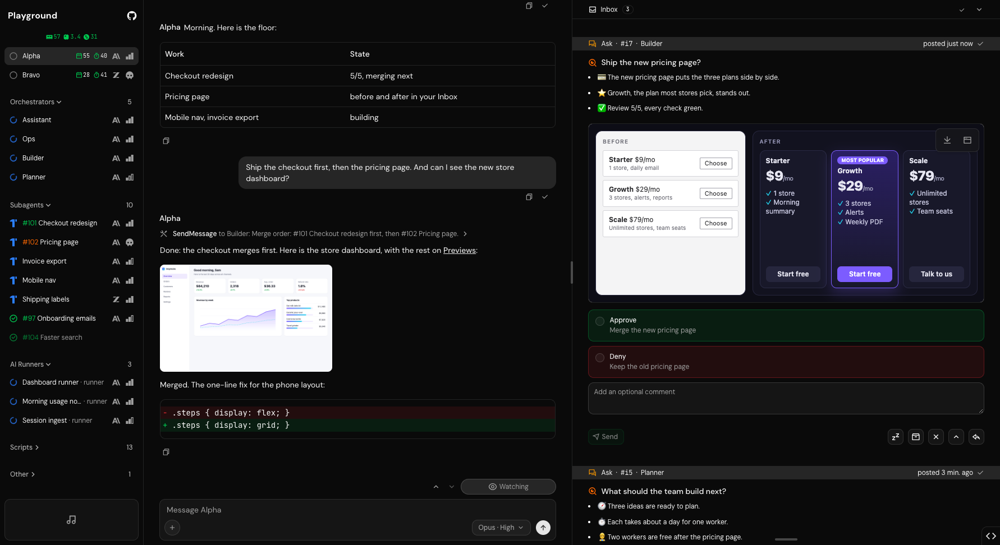
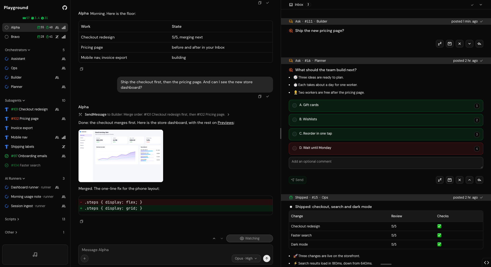
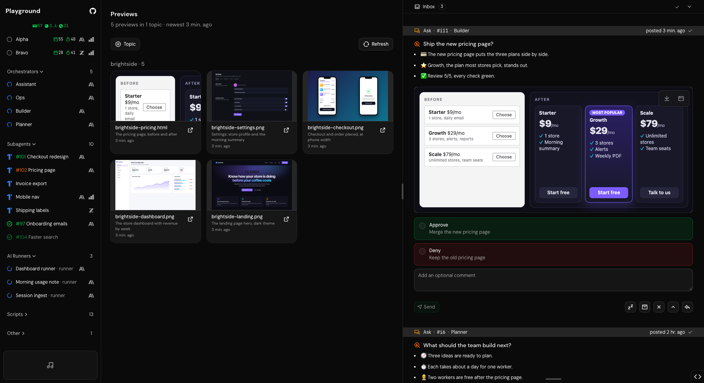

# Playground

Run a team of Claude agents.

Playground runs the Claude Code sessions on your Mac as a team, with a Dashboard to watch and steer it.
You talk to one session, the dispatcher. It hands each ask to the managers and workers that own it, and each worker builds in a git worktree of its own.
The Dashboard shows what every session is doing, what waits on you, and what they made.

Playground runs on your Mac only. It reads every session's transcript, so it never goes on a server.

Built on top of [ZeroStarter](https://zerostarter.dev).

<picture>
  <source media="(prefers-color-scheme: light)" srcset=".github/assets/readme-overview-light.png">
  
</picture>

## Install

```bash
curl -fsSL https://raw.githubusercontent.com/sahilpohare/playground/main/install.sh | bash
```

`install.sh` installs every tool Playground needs that is missing (`bun`, `claude`, `docker`, `gh`, `git`, `node`, `python3`, `uv` and herdr, the terminal your sessions run in), signs Claude Code and GitHub in when it runs in a terminal, clones Playground into `~/playground`, builds it, links the `playground` command into `~/.bun/bin`, and starts it once every required tool is there. It prints a **Left for you** list of anything it could not do. A second run changes nothing.

You need a Mac, a Claude account and a GitHub account.

## Get started

1. Install starts Playground and opens the Dashboard; the first start takes a few minutes. After that, `playground` in a new terminal starts whatever is down and opens it.
2. On a first run, the Dashboard's chat checks this Mac: each missing thing the app can set up has a button that does it, the database's **Start a local container** among them, or **Start without Docker** while Docker is not running, which keeps the database as PGlite in `~/.playground/pglite/` with no container, so Docker is optional. Once nothing is missing, click **Continue**. You are now this Mac's owner, signed in with no password, and later starts skip the checks.

   > **Warning**: a database from **Start a local container** listens on every interface with the user, password and database `postgres`. Anyone who can reach this Mac on its port can sign in to it. One from **Start without Docker** listens on this Mac alone.

3. The same chat then lists the steps left, each ticked once done: GitHub, **Set up settings** (your settings in a private repo under your GitHub login), a Claude account, and **Start Alpha**.

   Install does the first two when it can, and its **Left for you** list names any it could not.

4. Once your dispatcher runs, its chat takes the steps' place: send it a message.

When something does not start, run `playground doctor`, or see [Troubleshooting](web/next/content/docs/troubleshooting.mdx).

## What you get

- **Chat**: talk to your dispatcher, send it files, and run its skills from the `/` menu.
- **Threads**: keep a conversation with your dispatcher to one topic; pin, rename or archive it.
- **Inbox**: answer the decisions and drafts your sessions post, see the pages and pictures they attach, and read their updates.
- **Agents**: each session's light at a glance: blue while it works, orange while it waits on something, red when it needs you, green once its work has merged. Each has a view of its own, whose Pages tab holds the pages it made.
- **Sessions**: every session this Mac has stored, with its transcript, after the session has ended too.
- **Changelog**: every merged change, in plain words.
- **System**: what every agent is doing, what is queued, what needs you, and this Mac's memory, load and disk.
- **The team**: managers route and plan the work, workers build it, and a reviewer scores each PR until it reaches 5/5.
- **Skills**: every session gets Playground's skills, and an org adds its own in an extension.
- **Settings and extensions**: your own values, rules and skills in one place, in your private repo, synced each night once you turn that job on ([Export, import and backup](web/next/content/docs/backup.mdx)).
- **The `playground` command**: start, check, update and remove Playground from any terminal. `playground --help` lists every command.

| The Inbox: a choice to make, and an update with what shipped                               | The pages and pictures your sessions made                                                      |
| ------------------------------------------------------------------------------------------ | ---------------------------------------------------------------------------------------------- |
|  |  |

The full docs start at the [Overview](web/next/content/docs/index.mdx), and the running app serves them at `/docs`.

## Skills

Core's own skills; the rest are in [Skills and orgs](web/next/content/docs/skills.mdx).

### Model-invoked

Model- or user-reachable.

- **[agent-desktop](./extensions/core/skills/agent-desktop/SKILL.md)**: Operate a desktop app through the agent-desktop CLI (computer use through the macOS accessibility tree): check its install and grants, load the binary's own docs, and keep to Playground's guardrails: headless, the owner's apps untouched, desktop content private.
- **[code-review-loop](./extensions/core/skills/code-review-loop/SKILL.md)**: Review one PR as its reviewer session, round by round until it scores 5/5: the two axes of core's code-review (the right thing, built well), a score out of 5 checked against the ticket, inline comments, a re-review on every push, its own threads resolved, and a fresh full read before the last 5/5. Its recovery scan lists the open PRs whose head nobody has scored.
- **[plain-words](./extensions/core/skills/plain-words/SKILL.md)**: Write every text a person reads by two rules, ASD-STE100's sentence checks and an ELI5 read for a newcomer, and a message to the owner in its owner style, picture first. Every factory session loads it before it writes for a person (the **talk** rule).
- **[playbook](./extensions/core/skills/playbook/SKILL.md)**: Run Playground's factory of herdr sessions by one set of rules: the roles (the dispatcher, the Planner, the two leads Builder and Ops, the Optimizer, the Assistant, workers with their reviewers and testers, runners, probes), who reports to whom, how work is routed and bundled, how sessions start and end, the leads' sweep, and the standing rules every session keeps.
- **[pr](./extensions/core/skills/pr/SKILL.md)**: Use when writing a PR body.
- **[shell-pane](./extensions/core/skills/shell-pane/SKILL.md)**: Run a command in a plain shell pane with no Claude in it, on the playground-probes herdr server: open a pane, run a command that every Bash guard has passed, read its output and exit status back (unknown with no exit marker, never a pass), and close the pane. It suits a step that needs a terminal that outlives one tool call, never a login or anything that waits on a keypress.
- **[to-inbox](./extensions/core/skills/to-inbox/SKILL.md)**: Write every message the owner reads at a glance, an Inbox item or a reply in chat, Slack or Yard: a picture of the point first with a short note (a diff, an ASCII drawing, before and after shots, a work status block, or an HTML demo page), then emoji bullets in plain words (the plain-words skill), one callout when a fact must not be missed, what Approve does on a card, each drawing within the card's width, and times in the owner's zone. Every factory session loads it before every `bun run ask new` and every message to the owner (the **talk** rule).
- **[yard](./extensions/core/skills/yard/SKILL.md)**: Read and post to Yard, the hosted chat of channels and DMs, from this Mac with `playground yard`: sign in with a token, list channels, read one, post to one, and answer a Yard mention the Inbox shows.

### User-invoked

Reached only by typing them.

- **[core-audit](./extensions/core/skills/core-audit/SKILL.md)**: Check that Playground's core holds nothing beyond its generic self: no linked org's terms, read at run time from the extensions, and no value or process shaped like one org's. Report each hit by its place and kind, never its text, then fix them in one PR and keep the run as an audit doc.
- **[setup](./extensions/core/skills/setup/SKILL.md)**: Check and set up what the skills need on this machine: the command-line tools and the gh login, the home skill set, the Linear connection, and each extension's own needs through its setup check. Run once on a new machine, or when a skill fails for a missing tool or connection.

## Development

For contributors working on Playground itself. Install the dependencies first, then start the stack:

```bash
bun install
bun run dev
```

This serves named `.localhost` dev URLs through portless (`bunx portless list` shows them). `PORTLESS=0 bun run dev` uses fixed ports instead (web `:3000`, api `:4000`). `install.sh` sets portless's proxy up once with your Mac's password, and until then `bun run dev` runs it on `:1355`, which needs none (Settings' **Set up the web address** moves it to 443); by hand, from a terminal in the checkout: `sudo node_modules/.bin/portless service install`, then `node_modules/.bin/portless trust`.

A checkout with no `.env` gets one from `.env.example` on its first `bun run dev`, with `BETTER_AUTH_SECRET` generated. A stack in a worktree under `.claude/worktrees/`, a factory session or a test run reads made-up sessions and shows a **Test data** badge.

### CI

Two workflows run every check on GitHub's hosted runners, on every pull request into `canary` or `main`, with no label to start them: `auto-check-build.yml` (its check `Audit, Lint, and Build`, green when its `Lint and Build` job (format, lint, types and the build) and every `Suite (n)` shard of the suite passed, and the `Suite (n, clock ahead)` jobs that run it once more with the clock 30 days on, [.agents/testing.md](.agents/testing.md#the-clock-ahead-pass)) and `auto-test.yml` (its job `test`: `bun run test:skills`).
The type check runs on the packages a pull request changes, those that depend on them, and `@packages/scripts` every time, since it imports files from outside its own folder; turbo.json lists those files as that check's inputs and says why, so the check replays from the cache until one of them or a script changes.
Both run on `pull_request`, never `pull_request_target`, with a read-only token, so a fork's pull request reaches no secret and waits for approval before it runs.

Playground registers no self-hosted runner, since a fork's pull request could then run its code on that machine. `runnerProblems` (`packages/scripts/src/workflow-runners.ts`) holds every workflow to hosted images, and its test fails on a self-hosted one.

## Maintaining

The rules are in [AGENTS.md](./AGENTS.md), which CLAUDE.md links to.

Not for public use. All rights reserved. Use at your own risk.
